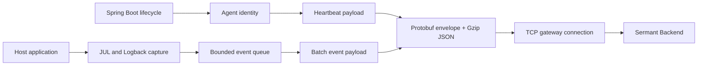

# Sermant Backend integration plugin

## Goal

Make `j-agent-plugin` appear as an agent instance in Sermant Backend and report WARN/ERROR logs as Backend events. The plugin connects directly to Sermant Backend's Netty gateway; it does not depend on a Sermant Agent process.

## Data path

The wire format follows Sermant's `NettyMessage` protocol: a varint length-prefixed protobuf envelope with one `ServiceData` entry. Data type `0` carries heartbeat JSON and data type `1` carries event JSON; the JSON bytes are Gzip compressed. The gateway is normally reachable at port `6888`; port `8900` is the Backend web UI.

## Java package responsibilities

| Package | Responsibility |
| --- | --- |
| `config` | Read and validate plugin properties |
| `model` | Host, process, application and instance identity |
| `lifecycle` | Read `spring.application.name` after Spring Boot starts |
| `event` | Capture JUL/Logback WARN/ERROR logs, deduplicate and bound the queue |
| `transport` | Build Backend JSON, encode Sermant protobuf framing and maintain TCP connection |
| `service` | Schedule heartbeats and event batches; release resources on stop |

## Runtime behavior

- Heartbeat reports host, IPs, process, app/service name, instance ID and the `j-agent-plugin` version.
- Spring Boot `spring.application.name` is read from the live Environment through the existing Agent API lifecycle bridge. Non-Spring applications can set the service and app names in plugin configuration.
- WARN and ERROR records from JUL and Logback become Sermant `LOG` events. The event buffer has a configurable hard limit, repeated entries are suppressed for a configurable window, and sensitive `password`, `token` and `secret` assignments are masked.
- The TCP connection is lazy, persistent and re-established on later heartbeat/event sends after connection failures. Plugin stop removes log handlers, unregisters the transformer, flushes queued events where possible, stops scheduled tasks and closes the socket.
- No log files are transferred. The plugin does not send JVM/host metrics because Sermant Backend's heartbeat and event pages do not expose a generic metrics ingestion API; metrics require the Sermant monitoring/Prometheus path.

## Configuration and rollout

Copy `plugins/sermant-backend/conf/config.properties.example` to `config.properties`, set `sermant.backend.address` and `sermant.backend.port`, then add `sermant-backend` to `plugins.enabled` in `agent.yaml`. Keep the plugin opt-in by default so an Agent without a reachable Backend does not create connection warnings.

